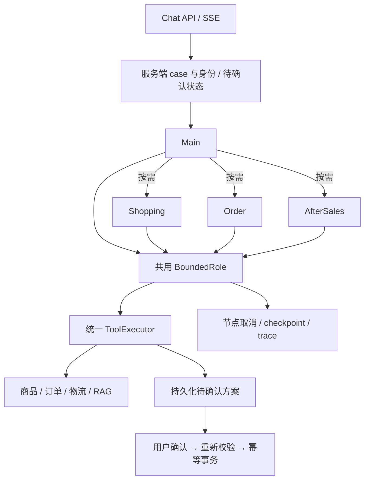

# Business Agent Harness

本次是执行底座和业务角色重构。历史实现保存在提交 `94052bc` 与
`baseline/pre-business-agent-refactor-20261020`；生产代码不保留旧运行入口。



## 唯一执行路径

`app/harness/agentic_core.py` 是唯一生效的有界模型和工具循环。旧 `runner.py`、
`context.py`、强制 Policy 委派策略已删除。`runtime.py` 不执行第二个模型循环，
只提供异步节点、取消和应用自有 checkpoint 接口；节点不自动重试。

Main 具备与单 Agent A 组相同的业务工具权限，B 组额外开放深度为一的 `delegate_task`。
简单任务直接处理。Shopping 管购买前商品咨询，Order 管订单、配送与未发货取消，
AfterSales 管退货退款及申请准备。专家可以直接共享商品、订单和知识只读工具，
没有互相委派能力。没有直接换货接口。

首版允许同一模型响应中两个标记为 independent 的委派并行执行；服务端将这类
专家的工具集收窄为只读，避免模型仅凭 independent 标记并行创建操作方案。
依赖任务由 Main 顺序调用，不引入 DAG。

## evoagent 复用范围

参考代码修订 `c219a2db303ba33d70feadf454c4bd7dc102b23f`，未修改 evoagent。
这属于提取和异步适配设计，不是原样复制整个运行框架。

| 来源 | commerce 内部实现 | 改动 |
| --- | --- | --- |
| runtime.py | harness/runtime.py | 异步节点、取消、应用 checkpoint；无自动节点重试 |
| agentic_core.BoundedRole | harness/agentic_core.py | 重写为原生异步 tool-call 循环，复用 commerce 执行器与业务验收 |
| context_manager.py | harness/context_manager.py、memory/budget.py | ASCII/CJK 估算、调用前整理、最近观察保留、旧观察裁剪及统计 |
| telemetry.py | harness/telemetry.py、budget.py | 请求局部账本；模型与工具计数、Token、耗时、可配置单价计算 |
| observability.py | harness/observability.py | 可选 OTel span；不强行重置全局 TracerProvider |

不迁移 diff/hunk、Finding、扫描器、审查仲裁、固定五次调用、自进化或发布系统。
`ContextVar` 替代同步项目中的线程局部状态；同一请求的并行任务共享一个 RunBudget，
每个角色持有独立的局部额度视图。额度预留发生在 await 前，适用于单事件循环并发。

## 工具、证据与返回

真实注册工具决定权限。所有业务调用，包括专家调用和确认后的写入，均通过
ToolExecutor 的 Schema、身份、归属、状态、授权、预算与事务检查。
`search_knowledge` 只执行混合检索与重排，不生成答复、不额外运行审查。
完整 RAG 问答兼容服务未暴露为业务 Agent 工具。

专家返回 `completed / needs_input / pending_confirmation / out_of_scope / failed`，
包含 summary、服务器从真实工具观察提取的 facts、evidence_refs、artifact_refs、
missing_fields、pending_action_id 与 child_run_id。completed 只表示子任务结束。

原始观察保存在 artifacts、运行记录与 checkpoint 中。服务端将专家原始观察交给
确定性引用及状态检查；Main 模型只收到紧凑结果，不回灌专家完整历史。
摘要或证据被裁剪时标记不完整，不能将其当作完整原文。超大 read_artifact 也受
调用上下文上限约束。实时业务 artifact 过期后返回 STALE_OBSERVATION，需要刷新。

## 任务状态与确认

`RuntimeStateRow.facts_json.active_case` 保存 case_id、业务类型、负责角色、原目标、
订单与商品标识、阶段、缺失字段、待确认 ID、最近成功观察的引用和时间，以及少量
已委派子任务状态。补充信息继续当前 case；显式变更订单或取消任务可以结束旧 case。

禁止操作约束独立持久化到 case，再由服务端写入 ToolContext；模型提供的 goal、
context 或工具参数不能解除它。用户新的明确操作授权可以解除旧的咨询限制。
身份、归属、待确认与已执行状态仍以数据库记录为准。

写入顺序：准备持久化方案 → confirm_action_id → 重新查询当前业务状态 → 幂等事务 →
真实回执。重复准备同一方案返回相同操作 ID；不同方案不能覆盖仍待确认的方案。
取消当前任务会撤销其未确认方案，不撤回已执行操作。

## 预算、恢复与观测

单次上下文始终不超过 32K。请求累计 Token、模型数、工具数、委派数和总时限分别
计数；模型内的重试预留也进入同一个请求预算。角色有局部 Token、模型与工具上限，
专家不能消耗为 Main 留出的额度。停止原因保留在 trace；不靠增加全局步数收敛。
重复同参数工具调用有上限；最终一步关闭业务工具；输出修正最多一次。

checkpoint 保存终态节点结果、输入摘要、已消费预算、原截止时间和账本。
内部 `BoundedRole.run(..., run_id=..., resume=True)` 只恢复相同输入与相同用户/会话。
恢复待确认节点时重新读取 ActionRow：已执行则返回真实已保存回执，已撤销或过期则
明确拒绝，不重跑业务写入。未完成节点不作自动恢复或自动重试。

request/trace → Main run → 专家 run → model/tool call 通过标识关联。流式进度只
发送白名单字段，原始提示词、内部草稿和完整工具参数不进入进度事件。
OTel 导出由部署方配置；未安装时保持可运行。未配置有日期与币种的单价时费用为 null，
Token、耗时、失败调用和未知用量预留分别保留，不能把 null 当作零费用。

Critic 默认关闭。已保留可开关的独立审核和确定性 Main 修正能力；基础 A/B 两组均
强制关闭 Critic，避免把审查变化混入业务委派比较。

## 评测入口

以下命令仅作为交付入口，本次按用户要求没有执行重构后的真实模型 A/B：

```bash
AGENT_DELEGATION_POLICY=auto .venv/bin/python -m eval.agent_ab --provider agnes --llm --monitor
# 预先固定小样本；两组使用完全相同的 ID
AGENT_DELEGATION_POLICY=auto .venv/bin/python -m eval.agent_ab --provider agnes --llm --task-id agent_020 --task-id agent_040
```

默认对冻结开发集的同一 135 条任务运行 A/B，排除 31 条 Holdout。模型、知识库、
fixture、评分、请求预算一致。源数据和 source_id 家族划分不改，旧 Policy 分组只是
历史来源元数据，不再决定 B 的专家路由。历史系统结果单独标记，不混入新 A/B。

保留业务验收规则与语义待审状态；新增真实专家调用、分角色 Token、重复工具请求、
预算耗尽、虚假完成拒绝、端到端 P50/P95 等诊断。语义未审不能计为业务成功。

## 当前限制

- 用户已要求先完成代码、不继续调试。最新增补代码和测试尚未重跑，不宣称已通过完整回归。
- 没有执行重构后的 AGNES 任务、真实 A/B 或语义评测；不存在多 Agent 优于单 Agent 的实测结论。
- checkpoint 提供内部恢复接口；没有新增公网恢复端点，也不恢复执行到一半的模型循环。
- 会话互斥目前仍是进程内锁。跨进程确认由数据库事务与幂等保护；多 worker 会话调度仍需共享租约。
- OTel 导出器、价格表和生产数据库迁移尚未部署验证；外部工具的未知用量不能推算为实际费用。
