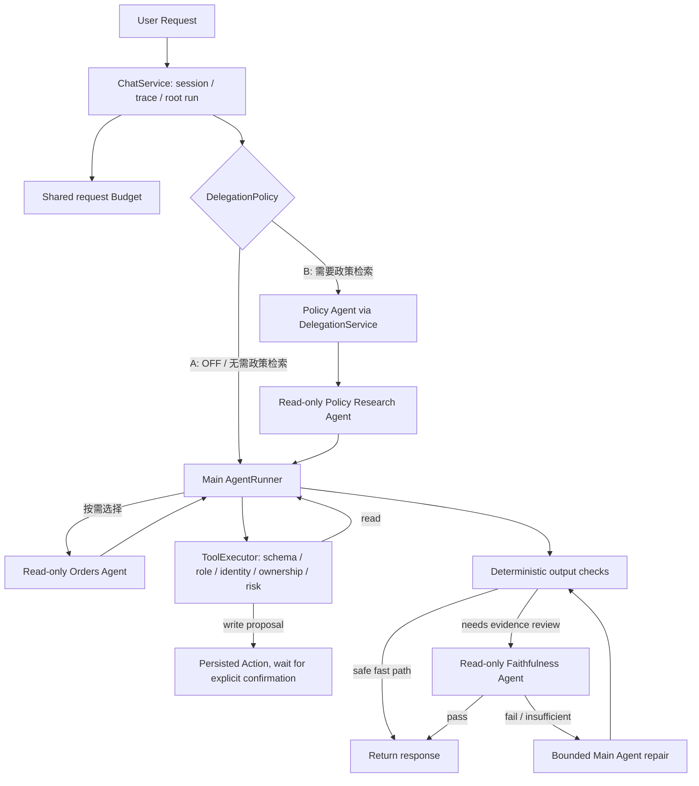

# Agent Harness 架构改造验收

本文件描述 `feat/policy-faithfulness-agents` 上的当前实现。五个阶段按独立提交完成；执行代码、检索工具、工具权限、会话状态和确认协议均沿用现有项目组件，没有引入新的 Agent 编排框架。阶段代码提交从纯检索到 Trace 持久化依次为 `edb01bb`、`ff7cca1`、`4e73b1a`、`e8082ff`。

## 当前请求路径



`ChatService` 在专家预检前建立 trace 和 root run，并加载已归属校验的会话历史、摘要、可信事实与待确认 Action。每个请求有一个共享 deadline、总 Token、模型调用、工具调用和委派预算。每次模型调用的上下文最多 32K；主 Agent 的必要续跑额度会在专家预检期间受到保护。

`AgentRunner` 是所有 Agent 的模型与工具循环。角色由 `AgentSpec` 限制工具：Main Agent 拥有当前业务所需工具；Policy 只允许 `search_knowledge` 与 `read_artifact`；Orders 只允许白名单只读业务工具；Faithfulness 只允许 `read_artifact`。所有工具调用继续经过 `ToolExecutor` 的参数 Schema、角色、服务端身份、资源归属、风险、deadline 和预算检查。子 Agent 的推理过程保存在独立 run 中，不会作为消息追加到用户历史。

评测只比较 A/B 两组：A 是单 Agent；B 在当前请求、历史或已确认事实表明需要知识检索时，强制运行 Policy Agent。策略不读取评测 ID、场景标签或期望答案。订单查询不强制委派；B 的 Main Agent 可以按需调用只读 Orders Agent，且委派 Schema 与执行器都只允许该角色。Policy Agent 的必需检索不由模型自行决定。`AUTO` 仍保留为兼容运行选项，但不属于本 A/B 对照。

## 检索与证据

生产工具 `search_knowledge` 每次只做检索：混合 BM25/BGE 召回、RRF 融合、去重、现有精排和缓存，然后返回完整 Chunk。输出保留 `chunk_id`、`document_id`、标题、版本、适用范围、条件、例外、来源及原文。工具内部不调用生成模型来改写 query、判断证据充分性、生成答案或自我纠错；需要其他角度时，由 Agent 基于已有观察构造新的 query 并显式再调用。

Policy Agent 最多执行三条不同 query。重复 query 被拦截并记录；结构化 `PolicyResearchResult` 和 `PolicyFinding` 经过 Pydantic 校验，所有引用必须在该子任务成功的检索观察中存在。无效或缺失引用会使结果不完整。父 Agent 收到规范化 `status`、`facts`、`evidence_refs`、`missing_fields`、`summary`、`child_run_id` 和结构化 findings；原始观察仍留在 root run 与受控 Artifact 中。政策 Chunk 不能充当订单事实。

`answer_question` 仍作为显式兼容 helper 保留，但不在生产 Agent 工具列表中。旧 Self-RAG 和查询改写代码也保留给兼容与离线用途，生产 `search_knowledge` 不再调用它们。

## 输出校验与纠错

候选答复先经过确定性检查：虚假来源、未知引用、退款/取消/提交完成声明、待确认 Action 状态和数据库回执。对精确服务端回执、没有工具观察的普通闲聊、已验证且原样返回的知识答案使用确定性快捷路径；其他依赖工具或政策证据的回答进入独立 Faithfulness Agent。

Faithfulness 输入包含原始问题、候选答复、原始工具观察、政策 Chunk、实际业务结果、可信会话事实、可用工具契约和允许的真实引用。输入过大时保存完整审核材料到会话归属 Artifact，并提示审核 Agent 先用 `read_artifact` 读取；主 Agent 的压缩仍保留 tool call/result 配对。Verdict schema 限定为 `pass`、`fail`、`insufficient_evidence`，引用由服务器再次校验。失败反馈回到 Main Agent；最多两次修正，每次修正后的候选仍重新经过校验。审核器或模型不可用时不能按通过返回。

审核不替代人工审批。高风险写操作继续由主 Agent 生成持久化 Action，只有用户后续明确提交 `confirm_action_id` 才执行服务端保存的参数；Faithfulness Agent 无写权限，也不能修改 Session Facts。

## Trace 样例

下面三组是**脱敏结构样例**，用于说明完整父子关系和事件内容，不是 Qwen/AGNES 实测记录。标识符与 Token 数为演示值；实际事件会写入每个请求自己的 `trace_id`、`run_id`、`parent_run_id`、`session_id`，并保留模型响应 usage 与耗时。完整事件不包含密钥或隐藏推理文本。

### 1. 简单订单查询

用户问“ORD10002 当前状态是什么？”。执行路径是 Main 查询订单、Faithfulness 核对数据库观察、返回状态；不会因问题简单而启动 Orders 专家。

```json
{
  "trace_id": "tr_simple_01",
  "session_id": "sess_demo_01",
  "root_run": {
    "run_id": "run_simple_01",
    "parent_run_id": null,
    "agent": "main",
    "status": "completed",
    "events": [
      {"event": "agent_started", "trace_id": "tr_simple_01", "run_id": "run_simple_01", "parent_run_id": null, "session_id": "sess_demo_01", "agent": "main"},
      {"event": "model_started", "trace_id": "tr_simple_01", "run_id": "run_simple_01", "parent_run_id": null, "session_id": "sess_demo_01", "agent": "main", "stage": "agent", "step": 1},
      {"event": "model_completed", "trace_id": "tr_simple_01", "run_id": "run_simple_01", "parent_run_id": null, "session_id": "sess_demo_01", "agent": "main", "model": "configured-model", "prompt_tokens": 900, "completion_tokens": 40, "total_tokens": 940, "elapsed_ms": 700},
      {"event": "tool_started", "trace_id": "tr_simple_01", "run_id": "run_simple_01", "parent_run_id": null, "session_id": "sess_demo_01", "agent": "main", "tool": "get_order", "tool_call_id": "call_order_01"},
      {"event": "tool_completed", "trace_id": "tr_simple_01", "run_id": "run_simple_01", "parent_run_id": null, "session_id": "sess_demo_01", "agent": "main", "tool": "get_order", "tool_call_id": "call_order_01", "status": "completed", "success": true, "elapsed_ms": 12},
      {"event": "model_completed", "trace_id": "tr_simple_01", "run_id": "run_simple_01", "parent_run_id": null, "session_id": "sess_demo_01", "agent": "main", "model": "configured-model", "prompt_tokens": 1200, "completion_tokens": 80, "total_tokens": 1280, "elapsed_ms": 600},
      {"event": "faithfulness_verdict", "trace_id": "tr_simple_01", "run_id": "run_review_01", "parent_run_id": "run_simple_01", "session_id": "sess_demo_01", "agent": "faithfulness", "verdict": "pass", "evidence_refs": ["get_order"]},
      {"event": "output_validation", "trace_id": "tr_simple_01", "run_id": "run_simple_01", "parent_run_id": null, "session_id": "sess_demo_01", "agent": "main", "status": "passed"}
    ]
  },
  "child_runs": [
    {"run_id": "run_review_01", "parent_run_id": "run_simple_01", "trace_id": "tr_simple_01", "session_id": "sess_demo_01", "agent": "faithfulness", "status": "completed", "tools": [], "model_calls": 1, "verdict": "pass"}
  ],
  "response": {"status": "completed", "tools": ["get_order"], "delegation_calls": 0, "citations": []}
}
```

### 2. 复杂政策追问与补检索

用户问“ORD10002 里的定制马克杯超过七天且有质量问题，能否退货？”。B 模式根据政策证据需求强制建立 Policy 子 run；Main 可以另外选择 Orders Agent 查询商品事实。Policy 第一次检索如果未覆盖定制商品的质量例外，会换一个 query 补检索；只有检索观察中的 Chunk ID 能进入结构化 findings。Main 合并真实订单商品与政策范围，再由 Faithfulness 审核最终回答。

```json
{
  "trace_id": "tr_policy_02",
  "session_id": "sess_demo_02",
  "root_run": {
    "run_id": "run_root_02",
    "parent_run_id": null,
    "agent": "main",
    "status": "completed",
    "events": [
      {"event": "delegation_plan", "trace_id": "tr_policy_02", "run_id": "run_root_02", "parent_run_id": null, "session_id": "sess_demo_02", "agent": "main", "mode": "required_when_eligible", "required_experts": ["policy"]},
      {"event": "delegation_started", "trace_id": "tr_policy_02", "run_id": "run_root_02", "parent_run_id": null, "session_id": "sess_demo_02", "agent": "main", "expert": "policy", "source": "policy_preflight"},
      {"event": "tool_completed", "trace_id": "tr_policy_02", "run_id": "run_policy_02", "parent_run_id": "run_root_02", "session_id": "sess_demo_02", "agent": "policy", "tool": "search_knowledge", "tool_call_id": "call_policy_01", "status": "completed", "success": true, "result_ref": "art_policy_01"},
      {"event": "policy_search_deduplicated", "trace_id": "tr_policy_02", "run_id": "run_policy_02", "parent_run_id": "run_root_02", "session_id": "sess_demo_02", "agent": "policy", "tool": "search_knowledge", "tool_call_id": "call_policy_repeat"},
      {"event": "tool_completed", "trace_id": "tr_policy_02", "run_id": "run_policy_02", "parent_run_id": "run_root_02", "session_id": "sess_demo_02", "agent": "policy", "tool": "search_knowledge", "tool_call_id": "call_policy_repeat", "status": "deduplicated", "success": false},
      {"event": "tool_completed", "trace_id": "tr_policy_02", "run_id": "run_policy_02", "parent_run_id": "run_root_02", "session_id": "sess_demo_02", "agent": "policy", "tool": "search_knowledge", "tool_call_id": "call_policy_02", "status": "completed", "success": true, "result_ref": "art_policy_02"},
      {"event": "delegation_result", "trace_id": "tr_policy_02", "run_id": "run_root_02", "parent_run_id": null, "session_id": "sess_demo_02", "agent": "main", "expert": "policy", "status": "completed", "child_run_id": "run_policy_02", "evidence_refs": ["chunk_return_custom_01", "chunk_quality_exception_02"]},
      {"event": "delegation_started", "trace_id": "tr_policy_02", "run_id": "run_root_02", "parent_run_id": null, "session_id": "sess_demo_02", "agent": "main", "expert": "orders", "source": "model"},
      {"event": "tool_completed", "trace_id": "tr_policy_02", "run_id": "run_orders_02", "parent_run_id": "run_root_02", "session_id": "sess_demo_02", "agent": "orders", "tool": "get_order_items", "status": "completed", "success": true},
      {"event": "delegation_result", "trace_id": "tr_policy_02", "run_id": "run_root_02", "parent_run_id": null, "session_id": "sess_demo_02", "agent": "main", "expert": "orders", "status": "completed", "child_run_id": "run_orders_02"},
      {"event": "faithfulness_verdict", "trace_id": "tr_policy_02", "run_id": "run_review_02", "parent_run_id": "run_root_02", "session_id": "sess_demo_02", "agent": "faithfulness", "verdict": "pass", "evidence_refs": ["get_order_items", "chunk_return_custom_01", "chunk_quality_exception_02"]}
    ]
  },
  "child_runs": [
    {"run_id": "run_orders_02", "parent_run_id": "run_root_02", "trace_id": "tr_policy_02", "session_id": "sess_demo_02", "agent": "orders", "status": "completed", "tools": ["get_order_items"], "facts": [{"item": "定制马克杯"}]},
    {"run_id": "run_policy_02", "parent_run_id": "run_root_02", "trace_id": "tr_policy_02", "session_id": "sess_demo_02", "agent": "policy", "status": "completed", "tools": ["search_knowledge", "search_knowledge"], "distinct_queries": 2, "evidence_refs": ["chunk_return_custom_01", "chunk_quality_exception_02"], "invalid_refs": []},
    {"run_id": "run_review_02", "parent_run_id": "run_root_02", "trace_id": "tr_policy_02", "session_id": "sess_demo_02", "agent": "faithfulness", "status": "completed", "tools": [], "model_calls": 1, "verdict": "pass"}
  ],
  "response": {
    "status": "completed",
    "delegation_calls": 2,
    "required_experts_complete": true,
    "citations": ["chunk_return_custom_01", "chunk_quality_exception_02"],
    "role_usage": {
      "main": {"model_calls": 2, "total_tokens": 2100},
      "orders": {"model_calls": 3, "total_tokens": 1150},
      "policy": {"model_calls": 4, "total_tokens": 1780},
      "faithfulness": {"model_calls": 1, "total_tokens": 520}
    },
    "elapsed_ms": 16800
  }
}
```

`policy_search_deduplicated` 事件只会出现在模型重复提交相同 query 的分支；它说明重复请求被挡住，不代表真实工具检索成功。真实执行路径也可以换 query 后只检索一次，或由 Main Agent 自行显式补检索，不要求固定工具顺序。

### 3. Faithfulness 失败后修正

主 Agent 首稿把一个限定品类的政策说成适用于所有商品。Faithfulness Agent 以真实 Chunk 为依据返回 `fail`；拒绝的草稿不发送给用户。Main Agent 对照原始条件和反馈修正答案，随后启动新的 Faithfulness 子 run 核对。若仍失败，最多再修正一次；到上限后以 `validation_failed` 或 `insufficient_evidence` 结束，不会返回 `completed`。

```json
{
  "trace_id": "tr_repair_03",
  "session_id": "sess_demo_03",
  "root_run": {
    "run_id": "run_root_03",
    "parent_run_id": null,
    "agent": "main",
    "status": "completed",
    "events": [
      {"event": "tool_completed", "trace_id": "tr_repair_03", "run_id": "run_root_03", "parent_run_id": null, "session_id": "sess_demo_03", "agent": "main", "tool": "search_knowledge", "status": "completed", "success": true, "result_ref": "art_evidence_03"},
      {"event": "faithfulness_verdict", "trace_id": "tr_repair_03", "run_id": "run_review_03a", "parent_run_id": "run_root_03", "session_id": "sess_demo_03", "agent": "faithfulness", "verdict": "fail", "issues": ["把数码商品限制泛化到全部商品"], "evidence_refs": ["chunk_digital_return_03"]},
      {"event": "output_validation", "trace_id": "tr_repair_03", "run_id": "run_root_03", "parent_run_id": null, "session_id": "sess_demo_03", "agent": "main", "status": "fail", "attempts": [{"stage": "faithfulness_agent", "verdict": "fail"}]},
      {"event": "output_repair", "trace_id": "tr_repair_03", "run_id": "run_root_03", "parent_run_id": null, "session_id": "sess_demo_03", "agent": "main", "attempt": 1},
      {"event": "model_completed", "trace_id": "tr_repair_03", "run_id": "run_root_03", "parent_run_id": null, "session_id": "sess_demo_03", "agent": "main", "stage": "agent", "step": 3, "prompt_tokens": 2200, "completion_tokens": 90, "total_tokens": 2290, "elapsed_ms": 650},
      {"event": "faithfulness_verdict", "trace_id": "tr_repair_03", "run_id": "run_review_03b", "parent_run_id": "run_root_03", "session_id": "sess_demo_03", "agent": "faithfulness", "verdict": "pass", "evidence_refs": ["chunk_digital_return_03"]},
      {"event": "output_validation", "trace_id": "tr_repair_03", "run_id": "run_root_03", "parent_run_id": null, "session_id": "sess_demo_03", "agent": "main", "status": "passed", "attempts": [{"stage": "faithfulness_agent", "verdict": "fail"}, {"stage": "faithfulness_agent", "verdict": "pass"}]}
    ]
  },
  "child_runs": [
    {"run_id": "run_review_03a", "parent_run_id": "run_root_03", "trace_id": "tr_repair_03", "session_id": "sess_demo_03", "agent": "faithfulness", "status": "completed", "verdict": "fail", "evidence_refs": ["chunk_digital_return_03"]},
    {"run_id": "run_review_03b", "parent_run_id": "run_root_03", "trace_id": "tr_repair_03", "session_id": "sess_demo_03", "agent": "faithfulness", "status": "completed", "verdict": "pass", "evidence_refs": ["chunk_digital_return_03"]}
  ],
  "response": {"status": "completed", "repair_attempts": 1, "citations": ["chunk_digital_return_03"]}
}
```

## 回归结果与模型评测状态

基线分支在本轮重构开始时为 **317 passed**。各阶段增加了检索纯度、结构化 Policy 结果、Faithfulness 修复、artifact 回读、Trace 归属与 SQLite 迁移等测试；当前全套 Python suite 为 **328 passed**。`0005` 已在旧版 `harness_runs` SQLite 表上验证升级并保留原记录；对应运行时 schema 测试也验证 user/session 归属和 Artifact 隔离。

重点自动化覆盖包括：检索工具只执行 retrieval node 且不调用生成 LLM；Policy Agent 对不足证据补充不同 query、去重重复 query、拒绝伪造引用并保留适用范围；Faithfulness 对无证据结论 fail closed、将不通过反馈给 Main Agent 并在有界修正后重新审核；大 Artifact 读取复用原引用而不是复制；root/policy/orders/Faithfulness run 共用 trace 并校验父级和会话归属；旧 SQLite 表前向补充 `trace_id`；已有订单、审批确认、幂等和跨用户拒绝测试继续通过。

最终离线检查：全套 pytest **330 passed**；`ruff check .`、全仓 `ruff format --check .`（201 个 Python 文件）和 Mypy（139 个源码文件）均通过。评测脚本和配对测试只做了 Ruff 格式化；格式化前后的 Python AST 相同，评测集与 fixture 没有变化。

| 指标 | 改造前已有实测 | 本次架构改造后 |
| --- | ---: | ---: |
| Qwen A 开发集通过 | 37/40 (92.5%)，commit `5a63af9` | 尚未运行 |
| Qwen C 开发集通过（仅历史对照） | 34/40 (85.0%)，commit `5a63af9` | 不适用于本次 A/B 设计 |
| Qwen A/C 模型调用、Token、平均轮耗时（仅历史） | 313/460 次调用；1,726,507/1,866,161 评测 Token；17.02/25.08 秒 | 新 A/B 尚未运行 |
| 确定性自动化测试 | 317 passed（重构前分支基线） | 330 passed |
| 测试语料 / Fixture / 评分规则 | 50 条任务文件，SHA-256 `376f0d6889862624f848832a409b687c511a503fb2a7207bf44e41f1346630bb` | 未修改 |

改造前 Qwen 结果的逐任务与失败分类见[历史完整 A/C 报告](qwen38-flash-full-ac-20261020.md)。它记录在本次架构重构前的代码提交 `5a63af9`，不能当成本分支改造后的成绩。用户要求只保留 A/B 对照且此前要求先不跑，因此新 A/B 开发集评测暂未运行；本次改造后的任务成功率、失败类型、模型调用数、Token 和耗时目前均未测得；自动化 Fake/offline 测试不替代真实模型评测。

本次未改动 `agent_tasks.jsonl`、`agent_comparison_50.jsonl`、fixtures、开发/保留划分或评分逻辑。保留集未用于调参。A/B 真实回归时将新结果保存到独立目录，避免覆盖 `eval/reports/qwen38_flash_ac_20261020/` 中的历史记录。

## 已知限制

- Qwen/AGNES 的新 A/B 开发集质量仍待真实模型评测；历史 Qwen C 低于 A，不能据架构设计推断本次已修复。
- Token 预算使用启发式估算，供应商未返回 usage 的失败请求采用保守预留；它不是账单精确值。
- Faithfulness 是与主模型同供应商/模型时可能相关的模型裁判，无法替代人工审查；通过 verdict 只能说明所给输入和引用通过当前规则。
- `user_id` 仍是演示 API 身份，不是公网可信认证。SQLite `init_schema` 仅对本地兼容做增量 trace 列，生产迁移仍应执行 Alembic。
- 本地订单、退款、物流和申请数据是演示仓储；尚未连真实支付、承运商或 Java 服务。多进程 session lease、进程中断后任意步骤恢复也未实现。

